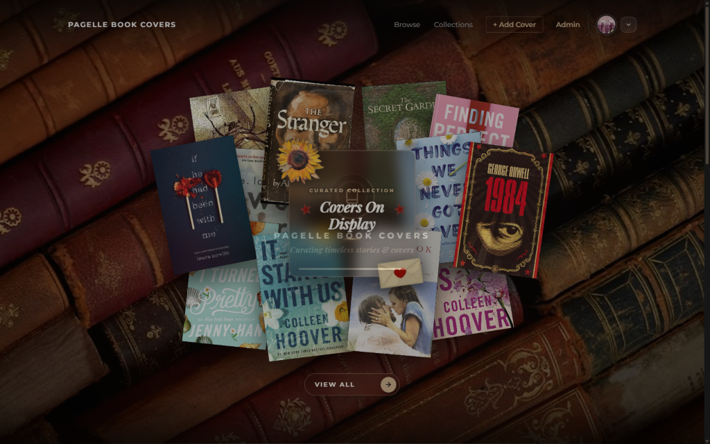
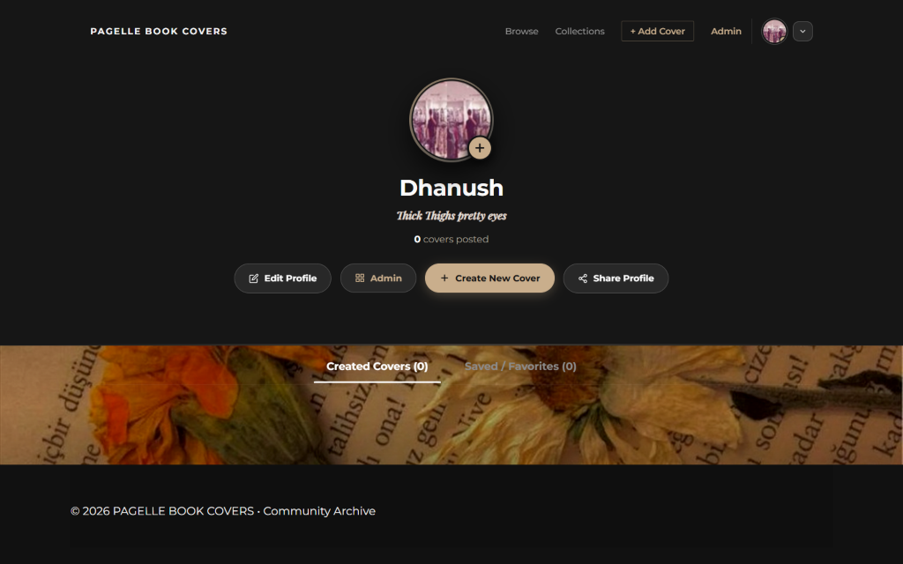

<div align="center">

# 📖 PAGELLE BOOK COVERS
### *Curated Editorial Book Jacket Gallery & Collector Community*

[](https://pagelle-book-covers.vercel.app)
[](https://github.com/dhanushdevaraj10-glitch/pagelle-book-covers)
[](https://pagelle-book-covers.vercel.app)
[](LICENSE)

<br />



<br />

**Pagelle** is an editorial platform and digital sanctuary for book jacket connoisseurs, graphic designers, publishers, and literary collectors. Built with a dark luxury aesthetic reminiscent of vintage European bookshops, rare private libraries, and contemporary art galleries.

[Explore Live Showcase](https://pagelle-book-covers.vercel.app) · [Browse Catalog](https://pagelle-book-covers.vercel.app/browse.html) · [Collections](https://pagelle-book-covers.vercel.app/collections.html)

</div>

---

## ✨ Key Features & Visual Walkthrough

### 1. Editorial Hero Collage & Kinetic Cluster
The landing experience features a dynamic collage of curated book jackets fanned across aged leather bindings and textured parchment paper. Layered vintage stickers (sunflower paper, love letter seals, star patches) and an editorial glassmorphic badge (*"Covers On Display"*) invite users to immerse themselves in cover art.

* **Dynamic Viewport Scaling**: Mathematical scale matrices keep the collage harmoniously proportioned across all screen dimensions.
* **Luxury VIEW ALL CTA**: Centered pill button with gold arrow circle and smooth micro-interactions.

---

### 2. Comprehensive Browse Gallery & Live Filtering
Navigate through hundreds of book cover designs with lightning-fast instant search and multi-category filtering.

<div align="center">
  
</div>

* **Interactive Genre Tabs**: Instant category switching across *All*, *Fiction*, *Sci-Fi & Fantasy*, *Mystery & Noir*, *Modernist*, *Classics*, and *Art & Design*.
* **Multi-Attribute Search**: Real-time debounce filtering by book title, author, designer, or publication era.
* **Flexible Sorting**: Sort instantly by *Featured & Newest*, *Title (A–Z)*, *Author (A–Z)*, or *Release Year*.
* **Responsive 2-Column Grid**: Perfectly aligned edge-to-edge on mobile with uniform card sizing and zero awkward margin gaps.

---

### 3. Pinterest-Style Lightbox & Pin Detail Modal
Clicking any book cover opens an immersive, distraction-free modal that celebrates the cover artwork.

<div align="center">
  
</div>

* **Artwork Stage**: Full-height, high-resolution cover preview with subtle luxury shadows.
* **Creator & Designer Attribution**: Clear credits for the author, cover illustrator, publication year, and publisher.
* **Interactive Actions**: One-click favorite bookmarking, high-res download, and native social sharing.
* **Community Comments**: Live threaded discussions with timestamps, avatar previews, and instant comment submission.
* **Full-Screen Zoom Mode**: Dedicated lightbox view with zoom controls for inspecting intricate typography and texture details.

---

### 4. Creator Profiles & Personal Showcases
Every user has a personalized profile celebrating their published cover designs and saved collections.

<div align="center">
  
</div>

* **Dynamic Stats**: Real-time counter of total book covers published and favorites collected.
* **Profile Customization**: Edit display name, biographical tagline, and upload custom profile avatars.
* **Tabbed Showcase**: Toggle between *Created Covers* and *Saved / Favorites*.
* **Multi-Account Switching**: Seamlessly manage Personal and Business accounts with quick switching in the header dropdown.

---

### 5. Silky, Touch-First Mobile Experience
Engineered for mobile excellence with zero sticky zooms, native momentum scrolling, and glassmorphic floating docks.

<div align="center">
  <table>
    <tr>
      <td align="center" width="50%">
        <b>Mobile Hero & Dock Navigation</b><br /><br />
        
      </td>
      <td align="center" width="50%">
        <b>2.5-Card Peeking Carousel</b><br /><br />
        
      </td>
    </tr>
  </table>
</div>

* **2.5-Card Peeking Carousel**: Features an exact mathematical formula `calc((100vw - 40px) / 2.5)` ensuring 2 full cards and a 50% cut of the 3rd card are visible, providing an immediate visual scroll affordance.
* **Floating Glassmorphic Bottom Dock**: Quick one-tap navigation between Home, Search, Collections, and Profile.

---

## 🎨 Design Philosophy & Aesthetic System

| Element | Specification | Visual Purpose |
| :--- | :--- | :--- |
| **Obsidian Dark** | `#161616` / `#121212` | Rich, non-reflective museum backdrop that makes cover art pop |
| **Champagne Gold** | `#c9ae8c` / `var(--accent)` | Warm metallic accents reminiscent of gold-leaf foil book bindings |
| **Serif Typography** | *Cinzel*, *Playfair Display*, *Georgia* | Literary elegance, timeless craftsmanship, and editorial authority |
| **Sans Typography** | *Montserrat*, *Inter*, system sans | Crisp legibility for controls, data counts, metadata, and body text |
| **Glassmorphism** | `backdrop-filter: blur(14px)` | Sophisticated frosted glass layers reflecting ambient background hues |

---

## 🛠️ Architecture & Technology Stack

* **Zero-Framework Purity**: Built entirely with standard **HTML5**, **CSS3**, and **Modern Modular ES6+ JavaScript**. No hefty bundle overhead, hydration delays, or framework dependencies.
* **Continuous Integration & Deployment**: Hosted on **Vercel** with automatic production deployments and edge routing.
* **Dual-Tier State Management**:
  * **Instant Client Persistence**: `localStorage` ensures zero-latency page transitions, offline capability, and instant state hydration.
  * **Cloud Backend Synchronization**: Modular sync functions (`syncCommunityCovers`, Supabase/REST endpoints) keep community covers updated across all users.
* **Responsive Layout Engine**: CSS Grid, Flexbox, CSS Custom Properties (`--hero-scale`, `--accent`), and responsive viewport units (`svh`, `vw`).

---

## 📂 Project Structure

```text
BookCover/
├── index.html              # Homepage with Hero Collage & Featured Carousel
├── browse.html             # Catalog Gallery with real-time search & filters
├── collections.html        # Curated thematic cover groupings
├── add-cover.html          # Community submission form for uploading jackets
├── profile.html            # User showcase, personal stats & saved jackets
├── login.html              # Clean luxury authentication & onboarding
├── admin.html              # Administrative portal & moderation tools
├── styles.css              # Unified design system, tokens & media queries
├── shared.js               # Core utilities, modals, state sync & header/dock
├── home.js                 # Landing page interactions & collage calculations
├── browse.js               # Gallery rendering, debounced search & filtering
├── profile.js              # Profile management & user showcase controllers
├── add-cover.js            # Cover upload engine, preview & data validation
├── data.js                 # Curated foundational catalog data
├── screenshots/            # High-resolution README showcase graphics
│   ├── hero-desktop.png
│   ├── browse-gallery.png
│   ├── book-detail-modal.png
│   ├── creator-profile.png
│   ├── mobile-hero.png
│   └── mobile-carousel.png
└── assets/                 # Backgrounds, book jacket assets & stickers
```

---

## 🚀 Getting Started & Local Development

No package installation or build steps are required. You can run Pagelle Book Covers directly in any browser:

### 1. Clone the repository
```bash
git clone https://github.com/dhanushdevaraj10-glitch/pagelle-book-covers.git
cd pagelle-book-covers
```

### 2. Run with a local HTTP server

Using **VS Code Live Server**:
* Right-click `index.html` and select **"Open with Live Server"**.

Using **Python**:
```bash
# Python 3
python -m http.server 3000
```

Using **Node.js**:
```bash
npx serve .
```

### 3. Open in your browser
Navigate to `http://localhost:3000` (or `http://localhost:5500` for Live Server).

---

## 🌐 Live Deployment

The latest production build is permanently hosted and accessible at:
👉 **[pagelle-book-covers.vercel.app](https://pagelle-book-covers.vercel.app)**

---

## 📄 License

Distributed under the **MIT License**. See `LICENSE` for more information.

<br />

<div align="center">
  <sub>Crafted with passion for book jacket design and typography.</sub><br />
  <b>© 2026 PAGELLE BOOK COVERS — Designed by Dhanush D</b>
</div>
